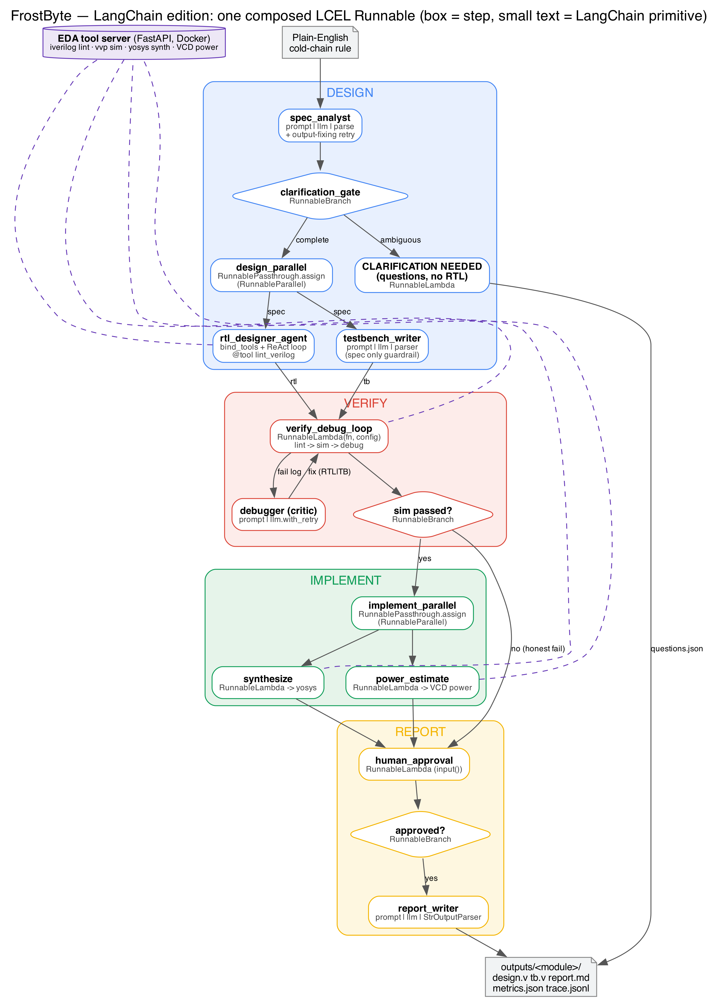
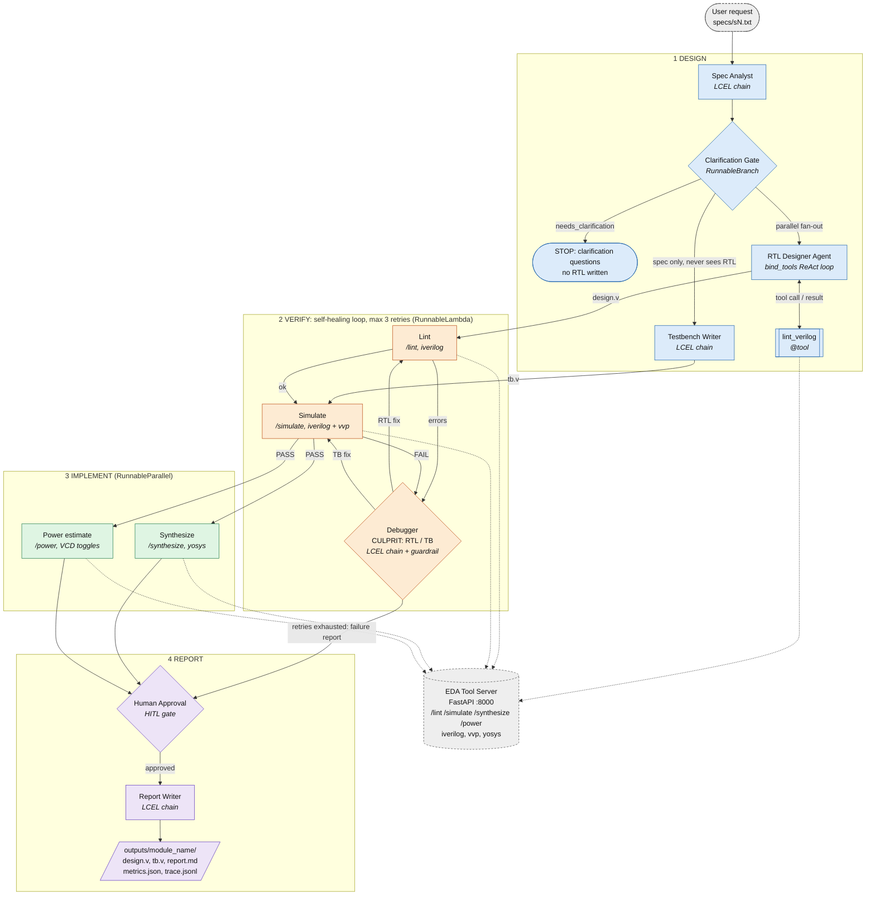
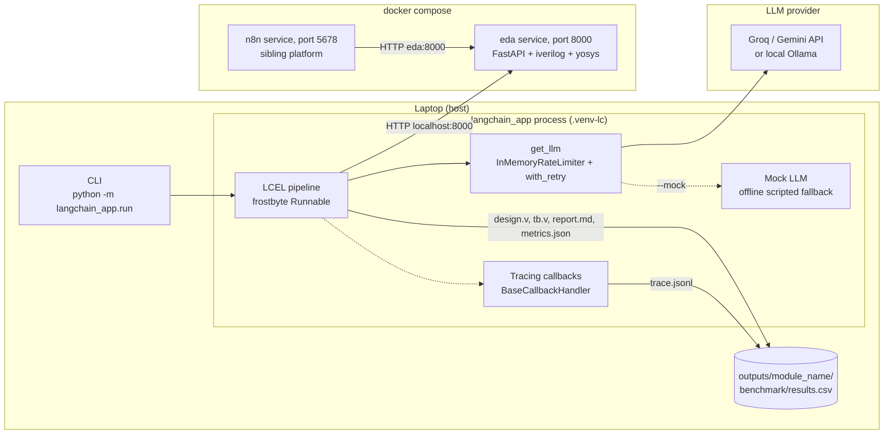
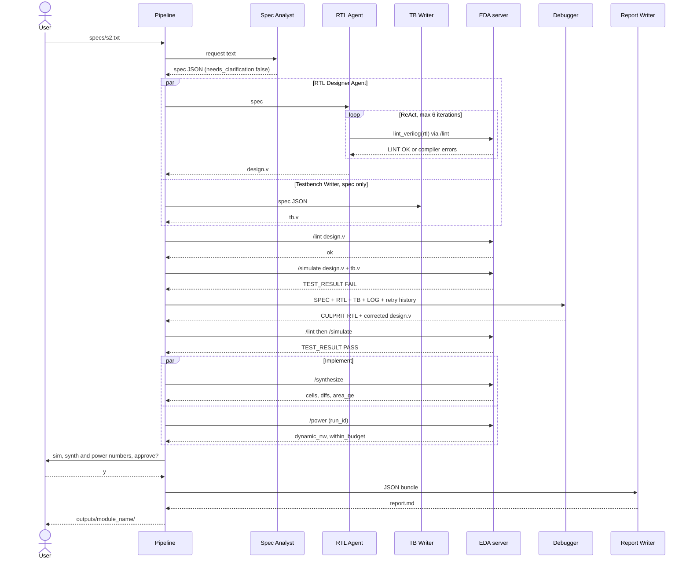

# FrostByte: Agents that turn vaccine cold-chain rules into verified silicon (LangChain edition)


-1C3C3C)


**Plain-English vaccine-storage rule in → verified, synthesized Verilog out.**

> **Project status: under construction.** This README describes the design that is being built in phases
> (see [Build status](#build-status)). Only the handbook ([docs/handbook.md](docs/handbook.md)) exists in the repo so far.
> Every item marked *(planned)* is not written yet, every number is `_TBD_`, and no command below has been run yet.
> This README will be regenerated from the real code and results once the build is finished.

---

## Table of contents

1. [Why this project (SDG-first)](#1-why-this-project-sdg-first)
2. [Why an agent (and not a chatbot or a script)](#2-why-an-agent-and-not-a-chatbot-or-a-script)
3. [Architecture](#3-architecture)
4. [Agentic AI concepts applied](#4-agentic-ai-concepts-applied)
5. [Repository structure](#5-repository-structure)
6. [The pipeline step by step](#6-the-pipeline-step-by-step)
7. [The five test specs](#7-the-five-test-specs)
8. [Quick start](#8-quick-start)
9. [Usage](#9-usage)
10. [Sample output](#10-sample-output)
11. [Tool server API](#11-tool-server-api)
12. [Benchmark and ablation results](#12-benchmark-and-ablation-results)
13. [Testing](#13-testing)
14. [Demo guide](#14-demo-guide)
15. [Troubleshooting](#15-troubleshooting)
16. [Limitations](#16-limitations)
17. [Known gaps / roadmap](#17-known-gaps--roadmap)
18. [Team and platforms](#18-team-and-platforms)
19. [Acknowledgements and licence](#19-acknowledgements-and-licence)

### Build status

| Phase | What | Status |
|---|---|---|
| 0 | Read the handbook, plan, check the toolchain | Done |
| 1 | Tool server (Docker), `common/`, `specs/`, smoke test, `tests/test_tools.py` | Not started |
| 2 | LangChain pipeline end to end with the mock LLM | Not started |
| 3 | Real LLM runs S1–S5 | Not started |
| 4 | Poster and Mermaid diagrams (`python -m langchain_app.diagram`) | Not started |
| 5 | Benchmark (10 runs) and ablation (MAX_RETRIES 0 vs 3) | Not started |
| 6 | Docs and poster content | Not started |

---

## 1. Why this project (SDG-first)

We started from the Sustainable Development Goals and only then picked the hardware. We did not build something first and attach an SDG logo afterwards.

**Problem.** Vaccines must stay within a narrow temperature range from the factory to the clinic. Both heat and accidental freezing can damage them, and the damage is invisible to the naked eye. Monitoring devices need tiny, always-on, battery-powered logic, but designing and verifying a custom chip is slow and needs specialist skills.

**Objective.** An agentic system that converts a plain-English storage rule into synthesizable Verilog. It verifies the Verilog with a real simulator, corrects itself from real tool errors, and reports area and a power estimate, using only open-source EDA tools.

### SDG mapping

| SDG | How FrostByte supports it |
|---|---|
| **SDG 3** Good Health and Well-being, target **3.8** (primary) | Makes it faster and cheaper to design the tiny monitor chips that watch vaccine storage temperature, which supports keeping vaccines potent from factory to clinic |
| **SDG 9** Industry, Innovation and Infrastructure, target **9.5** (supporting) | Lowers the barrier to custom chip design: a public-health rule goes in, and verified RTL and synthesis numbers come out, using only open-source tools |
| **SDG 4** Quality Education, target **4.4** (supporting) | Every run produces a readable log of what failed and why, so students learn RTL by watching the self-debugging loop |

FrostByte *supports* these goals. It does not *solve* them.

### SDG scorecard (from handbook Section 1; team judgement, each criterion scored 1–5)

| # | SDG and target | Real problem | VLSI bottleneck? | Simulatable? | Unique? | Total /15 |
|---|---|---|---|---|---|---|
| 1 | SDG 3, target 3.8 | Cold-chain breaks (heat or freezing) damage vaccines invisibly | 5 | 5 | 4 | **14** |
| 2 | SDG 7, target 7.3 | Smart-meter power optimisation | 3 | 4 | 2 | 9 |
| 3 | SDG 2, target 2.3 | Irrigation controller | 3 | 4 | 2 | 9 |
| 4 | SDG 6, target 6.1 | Water-quality sensor node | 3 | 3 | 3 | 9 |
| 5 | SDG 11, target 11.5 | Early-warning node | 3 | 2 | 3 | 8 |
| 6 | SDG 4, target 4.4 | A VLSI tutor chatbot | 2 | 4 | 1 | 7 |

> **Sources.** This README contains no health statistics. Cite WHO vaccine storage and handling guidance,
> WHO PQS specifications for temperature-monitoring devices and UNICEF Supply Division material yourselves.
> The temperature thresholds in our specs are illustrative.

---

## 2. Why an agent (and not a chatbot or a script)

1. **Multi-step planning.** The task breaks down into spec → RTL → testbench → lint → simulate → synthesize → power → report, with different specialist roles at each step.
2. **Real tool use.** An LLM alone cannot prove that Verilog is correct. FrostByte calls a real compiler (Icarus Verilog), simulator (vvp) and synthesizer (Yosys).
3. **Self-correction from tool feedback.** Compiler errors and failing simulation checks go back to a debugger, which repairs the code (at most 3 retries).
4. **Judgement.** On a failure, the debugger decides whether the RTL or the testbench is wrong, judging only against the spec. For an ambiguous request, the clarification gate asks questions instead of guessing.
5. **Human oversight.** Nothing is reported as released until a person has seen the simulation, synthesis and power numbers and approved them.

A fixed script cannot write Verilog from policy text, and a plain chatbot cannot verify its own output. FrostByte needs both.

---

## 3. Architecture

### A. Poster workflow diagram

<!-- Uncomment once Phase 4 has generated the file:

-->
*The poster diagram `docs/langchain_workflow.png` (plus `.svg` and `.mmd`) will be generated in Phase 4 by `python -m langchain_app.diagram` (planned). Until then, diagram B below shows the same workflow.*

### B. LangChain workflow (rendered by GitHub)

The whole system is **one composed LCEL `Runnable`** named `frostbyte` (planned in `langchain_app/pipeline.py`). The pipeline is drawn as four lanes. Each box shows the LangChain building block (primitive) that implements it. Dashed arrows are HTTP calls to the shared EDA tool server.



The planned composition this diagram is drawn from:

```python
frostbyte = (
    RunnablePassthrough.assign(spec=spec_chain)                         # 1 Spec Analyst
    | RunnableBranch(
        (needs_clarification, clarify_and_stop),                        # 2 Clarification gate
        RunnablePassthrough.assign(rtl=rtl_designer_agent,              # 3 parallel fan-out
                                   tb=itemgetter("spec") | testbench_chain)
        | verify_debug_loop                                             # 4 self-healing loop
        | RunnableBranch((sim_passed, implement_parallel), passthrough) # 5 synth || power
        | human_approval                                                # 6 HITL gate
        | RunnableBranch((approved, report_chain), passthrough))        # 7 report
)
```

### C. System and deployment architecture

Everything runs on one laptop. The `langchain_app` process talks to an LLM provider over the internet (or to a local Ollama). It talks to the EDA tools over HTTP to a Docker container. The teammate's n8n workflow runs in a second container and uses the **same** tool server, reaching it at `http://eda:8000` inside the Docker network.



### D. One S2 run with one retry (sequence)

The RTL agent and the testbench writer run **at the same time**. The testbench writer only ever receives the spec. When a simulation fails, the debugger gets the spec, RTL, testbench, failing log and retry history. It names the culprit and returns a corrected file.



---

## 4. Agentic AI concepts applied

All locations are *planned* (they will be confirmed against the code when it exists).

| Concept | Where in code | LangChain primitive | Why it matters |
|---|---|---|---|
| Tool-calling agent (ReAct loop) | `langchain_app/rtl_agent.py`: `lint_verilog`, RTL agent loop | `@tool`, `llm.bind_tools(...)`, `ToolMessage` | The model decides by itself when to compile its code and how to fix it |
| Role decomposition | `common/prompts.py`: `SPEC_SYSTEM`, `RTL_SYSTEM`, `TB_SYSTEM`, `DEBUG_SYSTEM`, `REPORT_SYSTEM` | One chain per role | Specialists with narrow instructions beat one giant prompt |
| Prompt chaining | `langchain_app/chains.py`: `spec_chain`, `testbench_chain`, `debug_chain`, `report_chain` | LCEL `prompt \| llm \| parser` | Each step's output becomes the next step's input |
| Routing | `langchain_app/pipeline.py`: clarification gate, `sim_passed`, `approved` | `RunnableBranch` | The flow changes based on what happened |
| Parallelization + TB isolation | `pipeline.py`: `design_parallel`, `implement_parallel` | `RunnablePassthrough.assign`, `RunnableParallel` | Faster, and the testbench cannot copy a bug from the RTL it never sees |
| Reflection / self-healing loop | `langchain_app/verify.py`: `verify_debug_loop` | `RunnableLambda` with config passed through | Real tool errors drive the fixes, capped at `MAX_RETRIES=3` |
| Critic / culprit classification | `verify.py` + `debug_chain` | LCEL chain + output parser | Decides whether the RTL or the TB is wrong, judged against the spec |
| Guardrails | Spec Analyst gate, `verify.py` weakened-TB check, tool server `total>0`, `extract_json` / `extract_code` | `RunnableBranch`, parsers | Refuses to guess, refuses to weaken tests, blocks vacuous passes |
| Short-term memory | `verify.py`: retry history passed to the debugger | Plain state in the Runnable input | Stops the debugger repeating a fix that already failed |
| Human-in-the-loop | `pipeline.py`: `human_approval` | `RunnableLambda` gate | A person signs off before the report is written |
| Observability | `langchain_app/tracing.py` | `BaseCallbackHandler` | Live console view plus `trace.jsonl` of every chain, LLM call and tool call |
| Reliability | `langchain_app/llm.py`, `langchain_app/mock_llm.py` | `InMemoryRateLimiter`, `.with_retry(...)`, `BaseChatModel` mock | Survives free-tier rate limits, and still demos with no Wi-Fi |
| Evaluation | `benchmark/summary.py`, `benchmark/ablation.py` | none (plain Python over `results.csv`) | Measured evidence, not anecdotes |

---

## 5. Repository structure

Only `README.md`, `docs/FrostByte_Handbook.docx` and `docs/handbook.md` exist today. Everything else is the planned layout.

```text
.
├─ README.md                    this file
├─ docker-compose.yml           (planned) eda tool server + n8n services
├─ .env.example                 (planned) template for LLM and EDA settings; real .env is never committed
├─ .gitignore                   (planned)
├─ requirements-langchain.txt   (planned) direct dependencies
├─ requirements.lock            (planned) pip freeze of the working environment
├─ docs/
│  ├─ FrostByte_Handbook.docx   team reference design
│  ├─ handbook.md               markdown conversion of the handbook
│  ├─ langchain_workflow.*      (planned) poster diagram: .svg, .png (300 dpi), .mmd
│  ├─ langchain_runnable_graph.mmd  (planned) auto-generated LCEL graph
│  ├─ POSTER_CONTENT.md         (planned) ready-to-paste poster panels
│  └─ VIDEO_RECORDING.md        (planned) demo video checklist
├─ tools/                       (planned) shared EDA tool server
│  ├─ Dockerfile, requirements.txt
│  ├─ server.py                 FastAPI: /lint /simulate /synthesize /power /health
│  └─ smoke.py                  4-bit counter end-to-end check
├─ common/                      (planned) shared with every platform
│  ├─ prompts.py                the five system prompts, verbatim from the handbook
│  ├─ utils.py                  extract_code, extract_json
│  └─ tools_client.py           HTTP client for the tool server
├─ specs/                       (planned) s1.txt ... s5.txt
├─ langchain_app/               (planned) this platform
│  ├─ llm.py                    get_llm: provider switch, rate limiter
│  ├─ chains.py                 LCEL chains for spec, TB, debug, report
│  ├─ rtl_agent.py              tool-calling RTL Designer agent
│  ├─ verify.py                 verify_debug_loop
│  ├─ tracing.py                callback handler: live console + trace.jsonl
│  ├─ pipeline.py               the composed frostbyte Runnable
│  ├─ run.py                    CLI
│  ├─ diagram.py                generates docs/ diagrams
│  └─ mock_llm.py               scripted offline LLM (S1, S5)
├─ tests/                       (planned) test_tools.py, test_pipeline_mock.py
├─ benchmark/                   (planned) results.csv, summary.py, ablation.py
└─ outputs/                     (planned) one folder per generated module
```

---

## 6. The pipeline step by step

| # | Step (`run_name`) | Input → output | Tool used | Failure handling |
|---|---|---|---|---|
| 1 | `spec_analyst` | Request text → spec JSON (ports, rules, ≥10 test scenarios, `clk_hz`, `power_budget_nw`) | none | Invalid JSON → one retry with a "valid JSON only" reminder |
| 2 | `clarification_gate` | Spec JSON → stop with questions, or continue | none | `needs_clarification: true` → print questions, write no RTL |
| 3 | `design_parallel` → `rtl_designer_agent` | Spec → `design.v` | `lint_verilog` (→ `/lint`) | Agent fixes its own lint errors (at most 3 attempts, 6 iterations); falls back to the last linted code |
| 3 | `design_parallel` → `testbench_writer` | Spec **only** → `tb.v` | none | The code asserts that the RTL never appears in its input |
| 4 | `verify_debug_loop` | RTL + TB → simulation result + retry history | `/lint`, `/simulate` | Debugger names the culprit (RTL/TB) and replaces only that file; lint failures are always RTL; weakened testbenches are rejected; stops at `MAX_RETRIES` |
| 5 | `implement_parallel` → `synthesize`, `power_estimate` | Passing RTL → cells, DFFs, area; nW vs budget | `/synthesize`, `/power` | Skipped if the simulation never passed |
| 6 | `human_approval` | Numbers → approve / decline | none | `--auto-approve` logs `approved_by: auto` |
| 7 | `report_writer` | JSON bundle → `report.md` | none | Uses only numbers present in the bundle |

### Temperature encoding (fixed contract shared by all platforms)

Signed 8-bit two's complement, **0.5 °C per LSB**. Safe band 2–8 °C. Freezing (≤ 0 °C) is the most severe event.

| Temperature | Encoded value |
|---|---|
| -1 °C | -2 |
| 0 °C | 0 |
| 2 °C (lower safe limit) | 4 |
| 8 °C (upper safe limit) | 16 |

---

## 7. The five test specs

| ID | Name | Difficulty | What it tests | Success criterion |
|---|---|---|---|---|
| S1 | Excursion debouncer | Easy | Counters, signed comparison, saturation | Simulation PASS and synthesis ran |
| S2 | Freeze/heat alarm FSM with latch (headline demo) | Medium | 4-state FSM, priority rules, latched alarm, acknowledge | Simulation PASS and synthesis ran |
| S3 | Min/max temperature logger | Medium | Signed-compare traps, synchronous clear | Simulation PASS and synthesis ran |
| S4 | Heat-dose integrator (vial-monitor style) | Hard | Width/overflow, saturating arithmetic, threshold | Simulation PASS and synthesis ran |
| S5 | Ambiguous request ("warns people when it gets too warm") | n/a | Clarification gate | Asks questions and writes **no** RTL |

**S2 clarification added by the team.** The handbook text for S2 does not say how `ack` interacts with the other inputs. We will append this sentence to `specs/s2.txt` (planned):

> ack has no effect in NORMAL or SUSPECT. In the ALARM states bad_count holds its last value until ack. If ack=1 and sample_valid=1 in the same cycle while in an ALARM state, ack wins and the reading is ignored.

---

## 8. Quick start

> None of these commands work yet. They are the planned interface.

### Prerequisites

- Python 3.11
- Docker Desktop (recommended) **or** native `iverilog`, `yosys` and `graphviz`
- An API key for Groq or Gemini, **or** a local Ollama install

### 1. Start the EDA tool server

```bash
# Docker route (recommended)
docker compose up --build -d eda
curl http://localhost:8000/health        # -> {"ok": true}
```

```bash
# Native route (Ubuntu / WSL2; on macOS use: brew install icarus-verilog yosys graphviz)
sudo apt install -y iverilog yosys graphviz
uvicorn tools.server:app --port 8000
```

### 2. Python environment

```bash
python3.11 -m venv .venv-lc
source .venv-lc/bin/activate
pip install -r requirements-langchain.txt
```

### 3. Configure `.env`

```bash
cp .env.example .env    # then paste your key into .env yourself
```

| Variable | Meaning | Example |
|---|---|---|
| `LLM_PROVIDER` | `groq`, `gemini` or `ollama` | `groq` |
| `LLM_MODEL` | Model name (same on every platform) | `_TBD_` |
| `GROQ_API_KEY` | Groq key (if `LLM_PROVIDER=groq`) | never commit |
| `GOOGLE_API_KEY` | Gemini key (if `LLM_PROVIDER=gemini`) | never commit |
| `EDA_URL` | Tool server URL | `http://localhost:8000` |

*(Final list confirmed in Phase 2.)*

### 4. Smoke test (no LLM involved)

```bash
python tools/smoke.py
```

Expected: lint `ok: true`; simulate `passed: true, total: 1`; synthesize `dffs: 4`; power `ok: true`.

### 5. First run in 60 seconds (offline mock LLM, real EDA tools)

```bash
python -m langchain_app.run specs/s1.txt --mock --auto-approve
```

---

## 9. Usage

Planned CLI (`langchain_app/run.py`):

```bash
python -m langchain_app.run specs/s2.txt                    # headline demo, asks for approval
python -m langchain_app.run specs/s5.txt                    # ambiguous: prints CLARIFICATION NEEDED
python -m langchain_app.run specs/s2.txt --auto-approve     # no prompt (benchmarks)
python -m langchain_app.run specs/s4.txt --max-retries 0    # disable self-healing (ablation)
python -m langchain_app.run specs/s2.txt --runs 3           # repeat runs, one CSV row each
python -m langchain_app.run specs/s1.txt --mock             # scripted offline LLM
python -m langchain_app.run specs/s2.txt --diagram          # print the LCEL graph
```

| Flag | Meaning |
|---|---|
| `--auto-approve` | Skip the human approval prompt; logs `approved_by: auto` |
| `--mock` | Use the scripted mock LLM (S1 and S5 only); EDA results are still real |
| `--max-retries N` | Override `MAX_RETRIES` (default 3) |
| `--runs K` | Run the spec K times |
| `--diagram` | Output the auto-generated Mermaid graph of the Runnable |

**Output files** in `outputs/<module_name>/`:

| File | Contents |
|---|---|
| `design.v` | Final RTL |
| `tb.v` | Final spec-derived testbench |
| `report.md` | Engineering report (written only after approval) |
| `metrics.json` | `ok, retries, seconds, cells, dffs, area_ge, power_nw, within_budget, llm_calls, lint_calls` |
| `trace.jsonl` | Every chain, LLM and tool start/end, with timestamps |

Example `metrics.json`: `_TBD: copied from a real run in Phase 3_`

---

## 10. Sample output

`_TBD: real excerpts from Phase 3 runs._` This section will hold:

- the live console of an S2 run
- the `TEST_RESULT: PASS total=N failed=0` line
- the Yosys cell summary
- the power line
- the S5 clarification questions

Any excerpt from a `--mock` run will be labelled **MOCK LLM (scripted) — EDA results are real**.

---

## 11. Tool server API

Base URL: `http://localhost:8000` from the laptop, `http://eda:8000` from inside Docker (n8n). Every POST accepts an optional `ctx` dict that is **echoed back unchanged**. Workflow tools such as n8n lose data between nodes; `ctx` lets the whole workflow state travel through each tool call.

| Endpoint | Request fields | Response fields | What it runs |
|---|---|---|---|
| `GET /health` | none | `ok` | none |
| `POST /lint` | `design_code`, `ctx` | `ok`, `log` (last 3000 chars), `ctx` | `iverilog -g2012 -Wall` |
| `POST /simulate` | `design_code`, `tb_code`, `ctx` | `passed`, `stage` (`compile`/`run`), `run_id`, `total`, `failed`, `log`, `ctx` | `iverilog` + `vvp` (30 s timeout) |
| `POST /synthesize` | `design_code`, `top`, `ctx` | `ok`, `top`, `cells`, `dffs`, `breakdown`, `area_ge`, `log`, `ctx` | `yosys` `synth -flatten` + `stat` |
| `POST /power` | `run_id`, `clk_hz`=32768, `vdd`=1.2, `cap_ff`=5.0, `tb_clk_ns`=10, `budget_nw`, `ctx` | `ok`, `toggles`, `cycles`, `toggles_per_cycle`, `dynamic_nw`, `budget_nw`, `within_budget`, `assumptions`, `ctx` | parses `wave.vcd` from that simulation run |

**Vacuous-pass block.** `passed` is true only if the log contains `TEST_RESULT: PASS`, `vvp` exited with code 0 **and** `total > 0`.

**Area.** Gate-equivalents (NAND2 = 1): NOT 0.5, NAND/NOR 1, AND/OR/ANDNOT/ORNOT 1.5, XOR/XNOR/MUX 2.5, DFF 5, LATCH 3.5, any other cell 1.5. This is an estimate, not a layout area.

**Power estimate.** Only signals inside the testbench instance named `dut` are counted; `x`/`z` transitions are ignored.

```text
cycles      = simulated_time_ns / tb_clk_ns
dynamic_nW  = (toggles / cycles) * 0.5 * C * V^2 * clk_hz * 1e9
              C = 5 fF per net toggle, V = 1.2 V, clk_hz = 32768 Hz
```

Assumptions: the stimulus is accelerated compared with a real fridge, so this is a conservative *relative* index for comparing designs. Leakage and clock-tree power are excluded. It is **not** a silicon power figure.

---

## 12. Benchmark and ablation results

**Protocol** (same on every platform): 10 runs, S1×2, S2×3, S3×2, S4×2, S5×1, with `--auto-approve` and a 2 s pause between runs. Model: `_TBD_`, temperature 0.2. Success means simulation PASS and synthesis ran for S1–S4, and questions with no RTL for S5. Mock runs are never counted.

| Metric | LangChain |
|---|---|
| Success rate (of 10) | _TBD: run Phase 5 benchmark_ |
| Avg retries | _TBD: run Phase 5 benchmark_ |
| Avg seconds per run | _TBD: run Phase 5 benchmark_ |

**Ablation** (S2 and S4, 5 runs each):

| Spec | MAX_RETRIES = 0 | MAX_RETRIES = 3 |
|---|---|---|
| S2 | _TBD_ | _TBD_ |
| S4 | _TBD_ | _TBD_ |

**Platform comparison** (teammates fill in their columns from their own runs):

| Dimension | LangChain | LangGraph | n8n | CrewAI | Dify |
|---|---|---|---|---|---|
| Success rate (of 10) | _TBD_ | | | | |
| Avg retries | _TBD_ | | | | |
| Avg seconds per run | _TBD_ | | | | |
| Retry loop | Python loop inside a `RunnableLambda` (planned) | | | | |
| Human-in-the-loop | approval step inside the Runnable (planned) | | | | |
| Time to first working version | _TBD_ | | | | |
| Debugging experience | _TBD_ | | | | |
| Best for | _TBD_ | | | | |

---

## 13. Testing

Planned:

```bash
pytest -q
```

| Test file | What it proves |
|---|---|
| `tests/test_tools.py` | The smoke-test results hold; a syntax error makes lint fail; a TB printing PASS with `total=0` gives `passed: false` |
| `tests/test_pipeline_mock.py` | Mock S1 shows 2 agent lint calls, 1 verify retry (CULPRIT RTL), then PASS with synthesis and power numbers; S5 asks questions and writes no RTL; the testbench writer never receives the RTL; system prompts containing `{ }` reach the model byte-for-byte |

---

## 14. Demo guide

**3-minute script**

1. *(20 s)* Run S5: the system asks questions. "It refuses to guess."
2. *(60 s)* Run S2 with the live console and narrate each stage. Point out a retry if one happens.
3. *(40 s)* Show the `TEST_RESULT` line, the Yosys numbers and the power line.
4. *(30 s)* Show the human approval step and the final report.
5. *(30 s)* Point at the comparison table: "Same task, several platforms, here is what we measured."

**Backup plan.** Have a pre-recorded video ready, and use `--mock` (offline, scripted LLM, real EDA tools) if Wi-Fi or the free API tier fails. The recording checklist will live in `docs/VIDEO_RECORDING.md` (planned, Phase 6).

---

## 15. Troubleshooting

| Symptom | Cause | Fix |
|---|---|---|
| `iverilog is not installed in the tool server` | Running natively without the EDA packages | Use Docker, or install `iverilog` and `yosys` |
| Tool server unreachable (`ECONNREFUSED localhost:8000`) from n8n | Inside Docker, `localhost` is the container itself | Use `http://eda:8000` inside Docker, `http://localhost:8000` from the laptop |
| `KeyError` / `INVALID_PROMPT_INPUT` when building a chain | The shared prompts contain literal `{ }` JSON, which `ChatPromptTemplate` treats as variables | Pass prompts as `SystemMessage(content=...)` or escape `{`→`{{` |
| `'RunnableRetry' object has no attribute 'bind_tools'` | `.with_retry()` was applied before `.bind_tools()` | Call `bind_tools` first, then `.with_retry()` |
| HTTP 429 / quota errors | Free-tier rate limit | Rate limiter + `with_retry` backoff; longer pause; switch to Ollama or `--mock` |
| `synthesize` returns `cells: 0` | Yosys `stat` layout differs from the regex | Read `log` in the response and adapt the regex in `tools/server.py` |
| `/power` says `wave.vcd not found` | TB is missing `$dumpfile("wave.vcd")` | Required by `TB_SYSTEM`; check the generated TB |
| Power is 0 or tiny | DUT instance not named `dut` | Required by `TB_SYSTEM`; check the generated TB |
| Simulation hangs | TB has no `$finish` | The 30 s timeout returns a `TIMEOUT` log, which the debugger sees |
| Same bug every retry | Debugger sees too little | Spec, RTL, TB, log and retry history must all be in the debug prompt |
| S4 keeps failing | Hardest spec (width and saturation traps) | Report it honestly with the retry history; that is a result |

---

## 16. Limitations

- **Generic-gate synthesis.** Yosys maps to generic cells, not a real standard-cell library, so area is a gate-equivalent estimate.
- **Power is an estimate.** It comes from switching activity with accelerated stimulus and excludes leakage and the clock tree. Use it to compare designs, not as a chip specification.
- **Simulation only.** There is no formal verification, no layout and no silicon.
- **LLM variability.** Results change between runs, which is why the benchmark repeats each spec.
- **Illustrative policy values.** The thresholds in the specs must be checked against official WHO/UNICEF documents before any real use.

---

## 17. Known gaps / roadmap

**Current gaps:**
- Phases 1–6 are not built yet (see [Build status](#build-status)).
- There is no `LICENSE` file yet.

**Spec issues found in Phase 0:**
- **S2 `bad_count` on entry to `ALARM_FREEZE` is unspecified.** When a freezing reading moves the FSM straight into `ALARM_FREEZE`, the spec does not say whether `bad_count` holds, resets or increments. RTL and TB may disagree.
- **S3 negative values.** The shared TB `check` task takes unsigned 64-bit inputs, so negative values must be sign-extended on both sides. Otherwise checks fail spuriously, and the failure messages print very large numbers.
- **Synthesis top name.** Synthesis uses the spec's `module_name` as the top module. If the LLM names the module differently, Yosys fails, so the pipeline should detect the real module name.

**Stretch ideas:**
- A real open cell library (Sky130) for real area numbers.
- S6: a 10-minute sample-tick prescaler from the 32.768 kHz clock.
- An SPI-lite readout port.
- Formal property checks (e.g. SymbiYosys).
- A per-vaccine policy library.

---

## 18. Team and platforms

| Member | Platform | Folder |
|---|---|---|
| `<Member A>` | LangChain (this edition) | `langchain_app/` |
| `<Member B>` | n8n | `<folder>` |
| `<Member C>` | `<platform>` | `<folder>` |
| `<Member D>` | `<platform>` | `<folder>` |

---

## 19. Acknowledgements and licence

Built on [Icarus Verilog](https://steveicarus.github.io/iverilog/), [Yosys](https://yosyshq.net/yosys/), [LangChain](https://www.langchain.com/) and [FastAPI](https://fastapi.tiangolo.com/). The reference design is the team's FrostByte Implementation Handbook ([docs/handbook.md](docs/handbook.md)).

Licence: MIT, unless a `LICENSE` file in this repository says otherwise.
