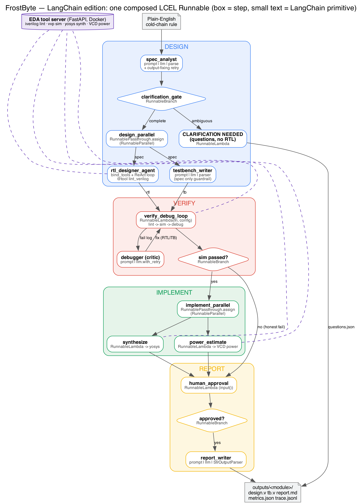
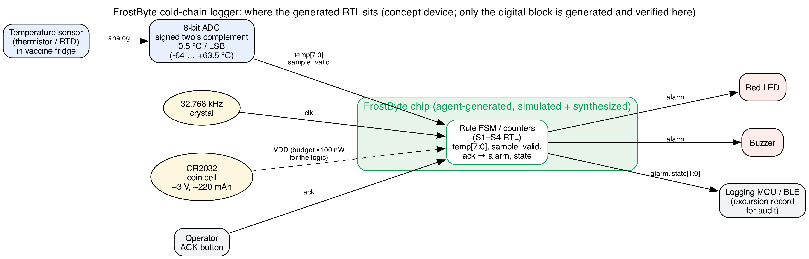
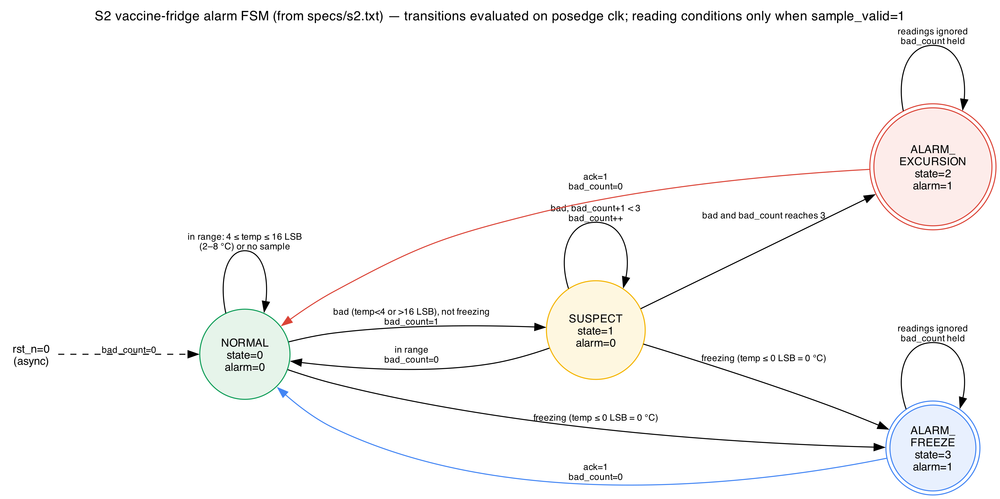

# Poster content: FrostByte (LangChain edition)

## Title
**FrostByte: Agents that turn vaccine cold-chain rules into verified silicon** · LangChain edition

Model: `ollama/qwen2.5-coder:7b`, temperature 0.2. Toolchain: Icarus Verilog 12.0 and Yosys 0.52, all open source.

## SDG mapping (SDG first)
| SDG | Target | How FrostByte *supports* it (it does not solve it) |
|---|---|---|
| **3 Good health (primary)** | 3.8 access to safe, effective vaccines | Always-on, ultra-low-power alarm logic that flags heat and freeze excursions which damage vaccines invisibly |
| 9 Industry & innovation | 9.5 research and technology capability | Open-source policy-to-silicon flow; no paid EDA licences |
| 4 Quality education | 4.4 technical skills | Teaches agentic AI and digital design together; reproducible on a laptop |

**Scorecard (why this problem):** high health impact; the logic is small enough for a student chip flow; real tools give measurable verification; open-source end to end.

## Problem
Vaccines must stay within a narrow temperature range (typically 2–8 °C) from factory to clinic. Both heat and accidental freezing can damage them, and the damage is invisible. Monitoring devices need tiny, always-on, battery-powered logic, but designing and verifying custom chips is slow and needs specialist skills.

## Objective
An agentic system that converts a plain-English storage rule into synthesizable Verilog, verifies it with a real simulator, self-corrects from real tool errors, and reports area and a power estimate against a budget.

## Why an agent (5 points)
1. **Tools, not trust:** the RTL agent decides when to call `lint_verilog` (iverilog) and keeps fixing until the code compiles.
2. **Feedback loops:** real simulator failures go back to a debugger (max 3 retries) instead of a person.
3. **Judgement:** the debugger decides whether the RTL or the testbench is wrong, judged against the spec.
4. **Knowing when to stop:** ambiguous rules get clarification questions, not guesses (S5).
5. **Human oversight:** a person approves the real numbers before the report is written.

## Agentic AI concepts → LangChain primitives
| Concept | Where | LangChain primitive |
|---|---|---|
| Planning / decomposition | spec_analyst → design → verify → implement → report | `RunnablePassthrough.assign` chain |
| Routing / guardrail | clarification gate, sim passed?, approved? | `RunnableBranch` |
| Parallelization | RTL ∥ testbench; synth ∥ power | `RunnableParallel` (via `.assign`) |
| Tool use (ReAct) | RTL designer calls `lint_verilog` | `@tool`, `.bind_tools()`, hand-written loop |
| Reflection / self-healing | verify_debug_loop | `RunnableLambda(fn, config)` |
| Critic | debugger names CULPRIT RTL/TB | prompt \| llm |
| Short-term memory | retry history in every debug prompt | state dict |
| Human-in-the-loop | human_approval | `RunnableLambda` + `input()` |
| Reliability | rate limit, backoff, output-fixing retry | `InMemoryRateLimiter`, `.with_retry()` |
| Observability | live console, trace.jsonl | `BaseCallbackHandler`, custom events |

## Input samples
- **S2:** "Design a vaccine-fridge alarm FSM … A reading is bad if temp < 4 or temp > 16. A reading is freezing if temp <= 0 …" (full text: `specs/s2.txt`)
- **S5 (ambiguous):** "warn when too warm" → the agent asks clarification questions and writes no RTL.

## Output samples
<!-- RESULTS:OUTPUTS -->
_TBD: filled from the real runs in outputs/_

## Hardware design & results
- Device: 
- S2 FSM: 
- S2 waveform (real simulation of the agent's RTL): 
- S1 synthesized netlist: `s1_netlist.svg`

<!-- RESULTS:HW -->
_TBD: hardware table from real metrics.json_

**Power model:** P = α · C · V² · f, with α = toggles per signal per cycle measured from the simulation VCD, C = 5 fF per net, V = 1.2 V, f = 32 768 Hz. It counts dynamic switching power only. It excludes leakage, real cell capacitance, wiring and clock-tree load, and the testbench stimulus is accelerated. It is useful for comparing designs, not for silicon sign-off.

## Results
<!-- RESULTS:BENCH -->
_TBD: run Phase 5 benchmark (`python benchmark/protocol.py`, `python benchmark/ablation.py`)_

### Platform comparison (fill in from each platform's measured runs; do not copy guesses)
| Dimension | LangChain (this) | LangGraph | n8n | CrewAI | Dify |
|---|---|---|---|---|---|
| Success rate (of 10) | _TBD_ | | | | |
| Avg retries | _TBD_ | | | | |
| Avg seconds per run | _TBD_ | | | | |
| Retry loop | Python loop inside a `RunnableLambda` | | | | |
| Human-in-the-loop | `RunnableLambda` + `input()` | | | | |
| Best for | composable, testable pipelines | | | | |

## Limitations
- Generic-gate synthesis, not a real cell library (area is in gate equivalents).
- Power is a switching-activity estimate with accelerated stimulus, not silicon power.
- Simulation only, no silicon; testbenches are LLM-written from the spec, so coverage is limited.
- LLM output varies between runs; a 7B local model fails some specs (reported honestly).
- Spec thresholds are illustrative and must be checked against WHO/UNICEF guidance before real use.

## 3-minute demo script
1. (20 s) S5 "warn when too warm": the agent asks questions. "It refuses to guess."
2. (60 s) S2 live: narrate spec → parallel RTL agent / testbench → verify loop (point at any retry) → synth ∥ power.
3. (40 s) TEST_RESULT line, Yosys numbers, power vs the 100 nW budget, waveform.
4. (30 s) Human approval and the final report.
5. (30 s) Results and ablation table: "measured, including failures."

## Viva Q&A
| Question | Answer |
|---|---|
| Why not just ask ChatGPT for the Verilog? | A chatbot cannot prove its answer. Ours compiles, simulates against spec-derived tests, synthesizes, and fixes itself from real tool errors. |
| What if the testbench is wrong? | It is written from the spec only (a guardrail asserts it never sees RTL). The debugger may blame the testbench, judged against the spec, but a fix that removes checks or the TEST_RESULT line is rejected. |
| Is the power number real? | No. It is a switching-activity estimate with stated assumptions, good for comparing designs. Silicon power needs a real cell library and layout. |
| How is this about SDGs? | We started from SDG 3.8 (vaccine access) and asked what chip logic protects vaccines, then built the tool for that. It supports the goal; it does not solve it. |
| What did the benchmark show? | Quote the measured numbers in Results, including failures and the 0- versus 3-retry ablation. |
| What would you do next? | Sky130 cell library for real area and power, a formal property check, and a policy library per vaccine type. |
| **Why LangChain and not LangGraph?** | We wanted to show how far plain LCEL composition goes: one Runnable that can be invoked, streamed, traced and drawn. Cycles (the retry loop) live in a small Python loop inside a `RunnableLambda`, explicit and testable. LangGraph adds checkpointing and resumable interrupts, which we would need for long-running human approval; we traded that for simplicity. |
| **Where exactly is the agent's autonomy?** | (1) The RTL designer chooses when to call `lint_verilog` and when it is done (ReAct loop). (2) The debugger chooses which file is wrong (CULPRIT RTL/TB) and how to fix it. (3) The spec analyst decides whether to ask questions instead of designing. Boundaries are fixed by us: retry cap, testbench-weakening guardrail, human approval. |

### ECE viva answers
| Question | Answer |
|---|---|
| Why an asynchronous active-low reset? | `always @(posedge clk or negedge rst_n)`: the device must reach a known safe state (NORMAL, counters 0) the instant power or the reset button acts, even if the 32 kHz clock is not running yet. Active-low suits power-on-reset circuits and pull-ups. Release should be synchronised to the clock in silicon to avoid metastability. |
| How is the temperature compared? | `temp` is signed 8-bit two's complement (0.5 °C/LSB), so it must be declared `signed` and compared against signed constants; otherwise −1 (8'hFF) looks like 255 and a freezing reading is treated as hot. Thresholds are in LSBs: 4–16 LSB = 2–8 °C. |
| Saturating vs wrapping arithmetic? | A plain `count + 1` wraps (3 → 0 for 2 bits), which would silently clear an alarm counter. Safety counters must saturate: `if (count != MAX) count <= count + 1`. The mock demo shows exactly this bug being caught by simulation and fixed. |
| What is a gate equivalent (GE)? | Area normalised to a 2-input NAND (= 1 GE), so results compare across technologies. We weight Yosys's generic cells (NOT 0.5, NAND/NOR 1, AND/OR 1.5, XOR/MUX 2.5, DFF 5). |
| Why is the power not silicon-accurate? | Generic gates have no real capacitance or leakage; we assume 5 fF per net, 1.2 V, and use a testbench with accelerated, unrealistic activity. Real power needs a cell library, parasitics after place-and-route, and realistic stimulus. |
| What is the next step to silicon? | Synthesize against the open Sky130 PDK cell library, run OpenLane (place and route, STA, DRC/LVS), get real area, timing and power, and tape out on an open shuttle. |
